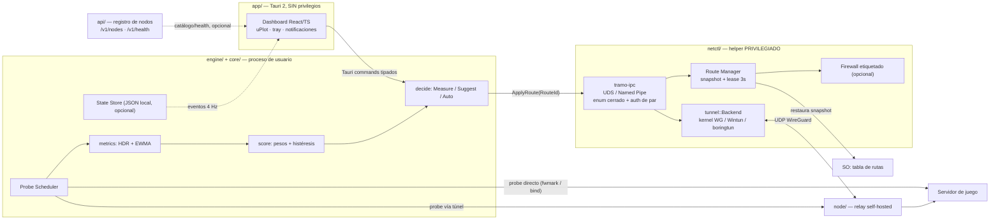

# Tramo — Propuesta técnica v0.1 (Fases 0 y 1)

> Documento de diseño inicial. Estado: **propuesta, pendiente de aprobación**.
> Fecha: 2026-11-03 · Licencia propuesta: Apache-2.0 · Lenguaje principal: Rust.
> Este documento es el entregable 1–6 de la solicitud; el código del MVP (entregables 7–12) se genera en una segunda iteración, previa confirmación.

---

## 0. Aviso legal, hallazgos del repositorio y supuestos

### 0.1 Hallazgo bloqueante de marca

El repositorio actual se llama `exitlagfree` y su único archivo (`README.md`) contiene `# exitlagfree`. Ese nombre incluye la marca de un tercero y entra en conflicto directo con la restricción «no usar el nombre ExitLag, su marca, su identidad visual ni afirmaciones que sugieran compatibilidad oficial».

**Acción propuesta (Fase 0, requiere decisión del dueño del repositorio):** renombrar el repositorio y la organización a `tramo` (o el nombre que se elija), y reemplazar todo el contenido del README. Mientras tanto, ningún artefacto nuevo de código, documentación, configuración, nombres de binarios, dominios, iconos ni metadatos de release usará la marca de terceros. Tampoco se usarán frases del tipo «alternativa a X», «compatible con X» ni comparativas de marca. La categoría se describe de forma genérica: *optimizador de red de código abierto y auditable para juegos*.

> Nota de proceso: la rama de trabajo de esta sesión es `arena/79abd4e1-exitlagfree` y es inmutable por diseño de la plataforma; el renombrado es del **repositorio**, no de la rama. GitHub redirige automáticamente la URL antigua.

### 0.2 Nombre del proyecto

**Tramo** (`tramo`, `tramo-*` para crates y binarios). Un «tramo» es un segmento de la ruta de red; es corto, pronunciable en español e inglés, no contiene términos de marca de terceros y no promete resultados («lag», «fast», «boost», «ping» quedan descartados por ser publicidad engañosa o por colisión con productos existentes). Es un nombre provisional sujeto a búsqueda de disponibilidad de dominio y marca (Fase 0).

### 0.3 Supuestos razonables adoptados (no bloquean el trabajo)

| # | Supuesto | Consecuencia |
|---|---|---|
| A1 | No existe ni se desea infraestructura central propietaria | El catálogo de nodos por defecto es un `nodes.json` local; el servicio `/api` es opcional y autohospedado |
| A2 | Los nodos relay son propios del usuario o de una comunidad de confianza | No hay cuentas, ni facturación, ni aprovisionamiento automático de claves en el MVP |
| A3 | Modo por defecto = **solo medir** | Cero cambios de rutas hasta que el usuario elija «sugerir» o «auto cambiar» |
| A4 | Telemetría **desactivada** y logs **desactivados** | Ninguna petición de red saliente salvo las que el usuario configure explícitamente (probes, catálogo, health, actualizaciones) |
| A5 | IPv4 obligatorio, IPv6 mejor-effort | El motor no asume IPv6; si está ausente, degrada con aviso en UI |
| A6 | Sin drivers propios firmados en el MVP | Split tunneling **por CIDR/puerto/protocolo**; por proceso solo en Linux mediante network namespace, no en Windows |
| A7 | Windows 10/11 x64 y Linux (glibc, kernel ≥ 5.6 con WireGuard en kernel) | macOS se documenta como Fase posterior |
| A8 | Juegos con anti-cheat son responsabilidad del usuario | El producto nunca intercepta memoria, paquetes de juego ni hooks; se documenta el riesgo de ToS |

### 0.4 Límites éticos explícitos

- No se realiza scraping de servicios privados, ingeniería inversa de clientes privados ni reimplementación de protocolos propietarios. Todo el código se escribe desde cero sobre estándares públicos (WireGuard [RFC documentado públicamente], ICMP/UDP/TCP, netlink, Wintun API pública).
- No se promete reducción de ping. Un relay **siempre** añade propagación + encapsulado; solo puede mejorar la ruta si evita un tramo congestionado o mal interconectado. Si la ruta directa gana, el motor mantiene la directa y la UI lo dice literalmente.
- No hay evasión de anti-cheat, modificación de juegos, inyección de paquetes, spoofing, bypass de sanciones ni ejecución remota de código. El helper privilegiado acepta **únicamente un enum cerrado de comandos locales** por IPC autenticado; nunca recibe scripts, rutas arbitrarias como shell ni binarios.
- No se recopilan datos personales sin consentimiento explícito; la configuración exportada **no incluye claves privadas** salvo opción explícita `--include-secrets` con advertencia.

---

## 1. Resumen ejecutivo

**Tramo** es una aplicación desktop open source, autohospedable y auditable que mide la calidad de la ruta de red hacia un servidor de juego, compara la ruta directa con una o más rutas a través de túneles WireGuard propios, y —solo si el usuario lo autoriza y las métricas lo justifican— enruta selectivamente el tráfico de un perfil de juego por la mejor ruta. Su diferencial no es «bajar el ping», sino **hacer visible y reproducible** por qué una ruta es mejor, con datos locales, logs opcionales, configuración exportable y cero telemetría por defecto.

**Propuesta de valor (técnica, no publicitaria):**

1. Medición continua con ICMP, UDP y TCP (según permisos y permisividad del firewall), p50/p95/p99, jitter, pérdida, MTU path discovery básico y traceroute simplificado.
2. Comparación honesta `directa vs túnel` con sondas separadas: las sondas directas se excluyen del túnel mediante `fwmark`/`SO_BINDTODEVICE` (Linux) o bind a la IP de la interfaz física (Windows, con limitación documentada).
3. Scoring configurable en unidades de «ms equivalentes», con histéresis, cooldown, límite de cambios, failover por degradación dura y tres modos: `MeasureOnly`, `Suggest`, `Auto`.
4. Control de plano de datos desacoplado y con privilegio mínimo: la UI y el motor corren sin privilegios; un *helper* pequeño y separado crea el TUN, aplica rutas y firewall con un **lease con heartbeat**, de modo que un crash restaura las rutas originales en segundos.
5. API de nodos autohospedada, sin PII, con health estático, API key opcional, rate limiting y OpenAPI; el cliente funciona en modo **offline** con un `nodes.json` local.
6. Nodo relay desplegable con Docker Compose y Ansible, más un laboratorio de red reproducible (`tc netem` en network namespaces) para medir detección, failover y falsos positivos.

**Alcance del MVP (mapeo a criterios de aceptación):**

| Criterio | Mecanismo en el MVP | Estado previsto |
|---|---|---|
| Medir latencia/jitter/pérdida a destino configurable | `probe` + ventana móvil HDR | ✅ Fase 2 |
| Comparar directa vs ≥1 túnel | dos *probe channels* con marcas de ruta distintas | ✅ Fases 2–3 |
| Activar/desactivar túnel sin romper la red | snapshot + lease + rollback atómico en `netctl` | ✅ Fase 3 |
| Enrutado selectivo | CIDR/puerto/protocolo en ambos SO; netns por proceso solo en Linux | ✅ parcial, con limitación documentada |
| Métricas en UI en tiempo real | eventos Tauri a 4 Hz + uPlot | ✅ Fase 6 (panel mínimo desde Fase 2) |
| Nodo recomendado por scoring | `core::score` + `core::decide` | ✅ Fase 5 |
| Fallo seguro sin permisos/firewall | preflight de capacidades, modo degradado a solo-medir | ✅ Fase 3 |
| Sin datos personales sin consentimiento | A4 + redacción en logs + export sin secretos | ✅ transversal |
| Documentar permisos admin/root | `docs/guides/permisos.md` | ✅ Fase 1 (borrador aquí) |
| Tests unitarios del scoring | `tests/unit/score_*.rs` (≥12 casos) | ✅ Fase 2 |
| Build reproducible | `scripts/build-*.sh`, lockfiles, CI con matriz | ✅ Fase 8 |

**Fuera de alcance del MVP (y del proyecto, salvo revisión legal):** driver WFP propio para split tunneling por proceso en Windows, firma de controladores, evasión de anti-cheat, optimización de throughput/qdisc, tunelado TCP sobre TCP, malla P2P, soporte macOS,panel de administración web multiusuario.

---

## 2. Comparación de stacks y decisión

### 2.1 Verificación de licencias (realizada contra los repositorios upstream el 2026-11-03)

| Componente | Licencia real | Impacto para un proyecto Apache-2.0 |
|---|---|---|
| `wireguard-go` | **MIT** ([LICENSE](https://github.com/WireGuard/wireguard-go/blob/master/LICENSE)) | Compatible. *Ojo:* históricamente fue GPLv2; hoy es MIT. Cualquier análisis que lo descarte por GPL está desactualizado |
| `boringtun` (Cloudflare) | **BSD-3-Clause** ([LICENSE.md](https://github.com/Cloudflare/boringtun/blob/master/LICENSE.md)) | Compatible, activo (último push 2026-06) |
| `wintun` / `wireguard-nt` | **GPLv2** ([COPYING](https://github.com/WireGuard/wintun/blob/master/COPYING)) | Son **drivers/binarios firmados separados**, usados por ABI público, no enlazados a nuestro código. Se distribuyen sin modificar con su aviso GPLv2 y ofrecimiento de fuente, o se requieren como componente del sistema |
| Módulo WireGuard del kernel Linux | GPLv2 | Se usa por **netlink (syscall)**; nuestro userspace no es trabajo derivado |
| Tauri | Apache-2.0 / MIT (dual) | Compatible |

Conclusión: **la licencia no es un impedimento para elegir Go**, porque `wireguard-go` ya es MIT. La decisión entre Go y Rust se toma por seguridad del plano privilegiado, huella de recursos y coherencia con el desktop, no por licencias. En cualquier caso, el grafo de dependencias se audita en CI con `cargo deny check licenses` (o `go-licenses` si se introduce un componente Go aislado).

### 2.2 Go vs Rust (motor de red)

| Dimensión | Go | Rust | Peso en la decisión |
|---|---|---|---|
| Seguridad de memoria en el helper (parsea paquetes, netlink, IPC de procesos locales no confiables) | GC + runtime, pero `unsafe`/CGO presente en libs TUN y escapes a punteros | Garantías en tiempo de compilación, sin GC, sin `unsafe` en el crate `core` (`#![forbid(unsafe_code)]`) | **Alto**. Es el componente con mayor superficie de ataque |
| Implementación WireGuard userspace lista | `wireguard-go` (MIT), muy madura, usada por clientes oficiales | `boringtun` (BSD-3), madura pero requiere integrar TUN/crypto-noise y gestión de handshake | Medio: ventaja Go |
| Bibliotecas de red | `x/net/icmp`, `vishvananda/netlink`, `wintun` Go bindings; excelentes | `socket2`, `tun2`, `rtnetlink`/`netlink-packet-*-`, `wintun-bindings`, `wireguard-uapi-rs`; completas pero más dispersas | Medio: ventaja Go |
| Cross-compilación Windows | `GOOS=windows go build`, trivial, binario estático | Requiere `cargo-xwin` (MSVC) o target `x86_64-pc-windows-gnu` + mingw; más fricción | Medio: ventaja Go |
| Desktop en el mismo lenguaje | Wails | Tauri 2 | Alto: ventaja Rust |
| Huella CPU/RAM (métrica de calidad exigida) | Runtime Go ~10–25 MB + GC; pausas sub-ms pero presentes en medición de jitter | Sin runtime, ~2–6 MB para el helper; latencia determinista en el muestreador | Alto: ventaja Rust |
| Velocidad de entrega inicial | 2–4 semanas menos | Más lenta (borrow checker, lifetimes en `tokio`) | Medio: ventaja Go |
| Auditabilidad / tipos compartidos UI↔motor | `encoding/json` + generadores | `serde` + mismos tipos en workspace + `schemars` para schema de config + `utoipa` para OpenAPI | Alto: ventaja Rust |
| Ecosistema de release firmada, bandeja, autostart | Wails + trabajo propio | Tauri 2: `updater` con Ed25519/minisign, `tray`, `notification`, `autostart`, `single-instance`, modelo de *capabilities* | Alto: ventaja Rust |

**Decisión: Rust como lenguaje principal, en un único Cargo workspace.**

Justificación del arquitecto + seguridad + desktop:
1. El *helper* privilegiado es el activo más sensible; memoria segura y `#![forbid(unsafe_code)]` en `core`/`ipc` reducen una clase entera de vulnerabilidades explotables por un proceso local o por paquetes malformados.
2. Tauri 2 resuelve de serie cinco requisitos funcionales (bandeja, notificaciones, autoinicio, actualizaciones firmadas, permisos de IPC del frontend) con un consumo de RAM muy inferior a Electron — requisito medible explícito del proyecto.
3. Un solo lenguaje, un solo lockfile (`Cargo.lock`), un solo schema de tipos (`serde`), un solo pipeline de auditoría (`cargo deny`, `cargo audit`, `cargo vet`) → más auditable, que es el principal diferencial del producto.
4. `boringtun` (BSD-3) cubre el túnel userspace; en Linux se prefiere **WireGuard del kernel vía netlink** (más rápido, sin drivers propios) y en Windows el backend **Wintun/WireGuardNT** vía ABI. Los tres implementan el mismo trait `TunnelBackend`.

**Coste aceptado y mitigación:** Rust es más lento de desarrollar y su cross-build a Windows es más delicado. Se mitiga con `cargo-xwin` en CI, con `Cross.toml`, y manteniendo `wireguard-go` (MIT) como **backend opcional aislado en subproceso** detrás del mismo trait si `boringtun` no cubre algún caso. Es un plan B explícito, no una dependencia del MVP.

**Alternativa rechazada:** Go + Wails. Es la opción correcta si el objetivo fuera un prototipo en 4 semanas; se descarta porque el requisito de privilegio mínimo auditable y la métrica de CPU/RAM pesan más que el time-to-market en un producto que se presenta como «auditable».

### 2.3 Tauri 2 vs Wails vs Electron (desktop)

| Dimensión | **Tauri 2 (elegido)** | Wails (Go) | Electron |
|---|---|---|---|
| Runtime web | WebView2 (Windows, *evergreen* o bootstrapper) / WebKitGTK (Linux) | Igual | Chromium empaquetado |
| Instalador / RAM típica | ~8–20 MB / ~80–150 MB | ~10–25 MB / ~90–160 MB | ~90–150 MB / ~250–400 MB |
| Mismo lenguaje que el motor | ✅ Rust | ✅ Go | ❌ requiere puente Node↔nativo |
| Bandeja, notificaciones, autostart | Plugins oficiales | Parcial / propio | Propio |
| Actualizaciones firmadas | `updater` + minisign Ed25519 incluido | A implementar | A implementar (+ electron-updater) |
| Modelo de permisos del frontend | *Capabilities* / ACL por comando | No equivalente | No equivalente |
| Superficie de ataque | WebView del SO (se actualiza con el SO) | Igual | Chromium completo a cargo del proyecto |
| Madurez / ecosistema | Alta, v2 estable | Media, v3 en consolidación | Muy alta |
| Riesgo | WebKitGTK en distros antiguas; WebView2 ausente en Windows limpio → bootstrapper | Madurez de plugins | Huella de recursos y CVEs de Chromium |

**Decisión: Tauri 2 + React + TypeScript + Vite + uPlot** (canvas, bajo CPU para series temporales) + CSS con variables para claro/oscuro, sin Tailwind ni frameworks de UI pesados, sin fuentes/CDN externos (privacidad y modo offline), sin SDK de analytics. Zustand o `useSyncExternalStore` para el estado de métricas.

**Electron se descarta** por RAM/CPU (métrica de calidad), superficie de ataque y por obligar a mantener un segundo ecosistema de build. **Wails se descarta** por coherencia con la decisión de Rust y por carecer de updater firmado y capabilities listos para usar.

### 2.4 Licencia del proyecto: Apache-2.0

Se elige **Apache-2.0** sobre MIT por cuatro razones concretas:
1. **Concesión de patentes explícita (§3)**, relevante en un dominio con patentes de routing/encapsulado y con contribuciones de terceros.
2. **Cláusula de marca (§6)**, coherente con el esfuerzo de no generar confusión con productos existentes.
3. **NOTICE y atribución de archivos modificados (§4)**, que facilita la auditabilidad cuando se incorporen fragmentos de implementaciones MIT/BSD.
4. Compatibilidad con MIT y BSD-3-Clause (nuestras dependencias), y separación limpia de los componentes GPLv2 (drivers) por ABI.

Se acompaña de: `LICENSE`, `NOTICE`, DCO (`Signed-off-by`), `deny.toml` con allowlist de licencias y CI que falla ante licencias nuevas no revisadas, `SECURITY.md`, `CODE_OF_CONDUCT.md` y política de divulgación coordinada.

---

## 3. Arquitectura recomendada final

### 3.1 Vista de componentes



### 3.2 Responsabilidades por módulo

| Módulo | Crate | Responsabilidad | ¿Privilegios? |
|---|---|---|---|
| `app/src-tauri` | `tramo-desktop` | Comandos tipados, eventos, tray, notificaciones, autostart, updater firmado, tema | No |
| `app/ui` | (TS) | Dashboard, gráficas, perfiles, toggle, modo, diagnóstico, export/import | No |
| `core` | `tramo-core` | **Puro, sin I/O**: percentiles, jitter, pérdida, scoring, histéresis, cooldown, modos de decisión | No |
| `engine` | `tramo-engine` | Orquestación: scheduler de probes, máquina de estados, bus de eventos, watchdog de handshake | No |
| `probe` | `tramo-probe` | ICMP / UDP / TCP, MTU discovery, traceroute simplificado, diagnóstico DNS/MTU/firewall | `CAP_NET_RAW` o `IcmpSendEcho` |
| `tunnel` | `tramo-tunnel` | Trait `TunnelBackend` + backends: Linux kernel WG (netlink), Windows Wintun/WireGuardNT, userspace `boringtun` | Solo en el helper |
| `netctl` | `tramo-netctl` + bin `tramo-helper` | TUN, rutas, `ip rule`/fwmark, WFP/netfilter etiquetado, snapshot/rollback, **lease** | Sí, mínimo |
| `ipc` | `tramo-ipc` | Transporte local (UDS con `SO_PEERCRED` / Named Pipe con SID), framing con límite de tamaño, enum de comandos, sin scripting | — |
| `config` | `tramo-config` | Esquema versionado (`schemars`), perfiles, reglas, umbrales, import/export con validación, secretos en keyring del SO | No |
| `api` | `tramo-api` | Axum: `/v1/nodes`, `/v1/nodes/{id}`, `/v1/health`, OpenAPI (`utoipa`), API key opcional, `tower-governor` | No |
| `node/agent` | `tramo-node-agent` | Exportador de salud: carga, versión, estado, etiqueta de ubicación estática; **sin PII ni logs de tráfico** | No |
| `cli` | `tramoctl` | CLI headless para medir, diagnosticar y ejecutar tests sin UI | No |

**Regla arquitectónica dura:** `core` no importa `tokio`, ni sockets, ni `netctl`. Es una biblioteca determinista de funciones puras sobre `&[Sample]` + `Instant` inyectado (reloj monotónico, inmune a cambios de hora/NTP/suspensión). Esto es lo que hace que el scoring sea unit-testeable y auditable sin red.

### 3.3 Flujo de datos y decisiones

1. `Probe Scheduler` emite sondas a intervalo configurable (por defecto 200 ms, ventana 60 s) por **cada ruta candidata**: `direct`, `wg-node-A`, `wg-node-B`…
2. Cada sonda lleva número de secuencia y timestamp monotónico; se marcan por canal para que el probe directo **no** atraviese el túnel (Linux: `SO_MARK` + `ip rule fwmark ... lookup main`; Windows: bind a la IP de la interfaz física — **limitación documentada**, no siempre fiable con Wintun).
3. `core::metrics` calcula p50/p95/p99 (HDR histogram, resolución 1 ms, 0–2000 ms), jitter (media de |ΔRTT| y variante RFC 3550), pérdida (huecos de secuencia con gracia de reordenamiento de 2 intervalos) y estabilidad.
4. `core::score` pondera; `core::decide` aplica histéresis/cooldown/failover; emite `Decision { route, reason, score_table }` con razón legible («directa gana por 14,2 ms», «failover: 15 timeouts consecutivos»).
5. En modo `Auto`, `engine` envía **un solo comando enumerado** `ApplyRoute(RouteId)` al helper; el helper aplica cambios de forma idempotente y devuelve un `AppliedRouteProof` (ruta efectiva verificada leyendo la tabla del SO, no asumida).
6. La UI recibe eventos agregados a 4 Hz (no por paquete) para no gastar CPU; el histórico se guarda solo si el usuario activa logs.
7. Al cerrar, al perder heartbeat o al fallar el túnel, el helper restaura el snapshot y libera las reglas de firewall que él creó (identificadas con etiqueta única `tramo-<uuid>`).

### 3.4 Algoritmo de scoring (propuesta por defecto, totalmente configurable)

Todo se expresa en **ms equivalentes**; menor es mejor.

```
loss_eq   = min(300, 300 * loss / max(0.05, 1 - loss))     # 1% -> 3,0 ms | 5% -> 15,8 ms | 20% -> 75 ms
tail      = p95 - p50                                       # cola de la distribución
jitter    = mean(|rtt[i] - rtt[i-1]|)                       # además se reporta la variante RFC 3550
instab    = clamp(0.6 * (jitter/20) + 0.4 * (flaps_10m/5), 0, 1)
load_term = 100 * load                                      # load ∈ [0,1], autodeclarado por el nodo
score(r)  = w_rtt * p50
          + w_jit * jitter
          + w_loss * loss_eq
          + w_tail * tail
          + w_load * load_term
          + w_stab * (10 * instab)
          + w_geo  * geo_cost_ms
```

Pesos por defecto y justificación:

| Peso | Valor | Justificación |
|---|---|---|
| `w_rtt` | 1,0 | Línea base: latencia media efectiva |
| `w_jit` | 2,0 | En juegos la varianza obliga a buffers/interpolación; +5 ms de jitter es peor que +5 ms constantes |
| `w_loss` | 1,0 | `loss_eq` ya convierte pérdida UDP en coste de ticks perdidos/retransmisión (≈300 ms por paquete perdido, saturado) |
| `w_tail` | 1,0 | Penaliza picos (p95–p50) que el promedio esconde |
| `w_load` | 0,5 | La carga es **autodeclarada y no confiable**; pesa poco y nunca supera a lo medido localmente |
| `w_stab` | 1,5 | Penaliza rutas que oscilan y el *flapping* propio del sistema |
| `w_geo` | 0,25 | Coste/jurisdicción/preferencia definida por el usuario en ms-equivalentes; **por defecto 0**, nunca inferida de la ubicación del usuario |

Reglas de seguridad del decisor:

- **Elegibilidad:** ≥20 muestras, ≥10 s de ventana, handshake <30 s, versión de health compatible, nodo en allowlist y prioridad del perfil. `direct` siempre es candidato, con `load=0` y `geo=0`.
- **Histéresis:** un retador solo gana si `score(retador) + H < score(actual)` durante `K=3` ventanas consecutivas de 2 s, con `H = max(8 ms, 0,12 * score(actual))`.
- **Cooldown:** 60 s entre cambios; máximo 3 cambios por 10 min. Superado el límite → se congela en la ruta actual y se muestra aviso de inestabilidad de red.
- **Failover duro (saltan cooldown e histéresis, pero no la elegibilidad):** pérdida >10% sostenida 2 s, o 15 timeouts consecutivos (≈3 s a 200 ms) → conmutar al mejor candidato sano. Se registra el motivo.
- **Datos de nodo ausentes:** `load=0,5` neutral + bandera `metadata_stale` (nunca 0, para no premiar al nodo que deja de reportar).
- **Modos:** `MeasureOnly` (por defecto; cero cambios), `Suggest` (badge en UI con la recomendación y su delta), `Auto` (aplica). El toggle de «optimización» no existe en `MeasureOnly`: se muestra deshabilitado con explicación.
- **Honestidad:** si ningún túnel supera a la directa, se mantiene la directa y la UI muestra «La ruta directa es la mejor; un relay añadiría X ms». Nunca se muestra «ping mejorado» sin delta medido.

Todos los pesos, umbrales, `H`, `K`, cooldown, intervalo y ventana viven en `config/profiles/default.json`, con JSON Schema generado y validación de rangos al importar.

### 3.5 Seguridad y permisos

| Aspecto | Windows | Linux |
|---|---|---|
| Proceso UI/motor | `asInvoker`, sin elevación | Usuario normal, sin root |
| Crear TUN | `tramo-helper.exe` como servicio (LocalSystem) o elevación puntual con manifiesto `requireAdministrator` vía **UAC** | Servicio systemd o binario con `setcap cap_net_admin,cap_net_raw,cap_net_bind_service+ep` |
| Elevación interactiva | UAC solo al instalar el servicio / al primer «activar túnel»; nunca en cada arranque | **polkit** `auth_admin` para la acción de instalación; `NoNewPrivileges=yes`, `AmbientCapabilities=CAP_NET_ADMIN CAP_NET_RAW`, `ProtectSystem=strict`, `PrivateTmp=yes`, `RestrictAddressFamilies=AF_UNIX AF_INET AF_INET6 AF_NETLINK` |
| Reducción de privilegios | El servicio expone solo un Named Pipe con SID del usuario; el proceso GUI nunca recibe el handle del driver | Tras crear el TUN se pasa el fd al proceso de datos y el helper conserva solo `CAP_NET_ADMIN`; las sondas con `CAP_NET_RAW` viven en un proceso hijo sin capacidades de routing |
| ICMP sin admin | `IcmpSendEcho` (no requiere elevación) | `CAP_NET_RAW` o ping socket (`net.ipv4.ping_group_range`) |
| IPC | Named Pipe + ACL por SID + `GetNamedPipeClientProcessId` | UDS `0600` + `SO_PEERCRED` (uid/pid) + límite de 64 KiB por mensaje + timeout |
| Firewall | Reglas WFP **etiquetadas** y numeradas, nunca `netsh` global; se permiten explícitamente UDP del endpoint WG, loopback, DHCP, DNS, LAN configurable | `nftables` en tabla propia `inet tramo` con comentario de etiqueta; no se tocan las reglas del usuario ni de la VPN corporativa |
| Restauración | El helper guarda un **lease** con heartbeat de 1 s; a los 3 s sin heartbeat revierte sus propias reglas y rutas | Idem, más snapshot de `ip rule`/`ip route` en archivo temporal con rollback atómico |
| Arranque automático | `tauri-plugin-autostart` por usuario (sin admin) | Unidad systemd *user* o `.desktop` en `~/.config/autostart` |
| Secretos | DPAPI / Credential Manager | Secret Service (libsecret) o archivo `0600` con advertencia explícita si no hay keyring |

**Kill switch (opcional, DESACTIVADO por defecto):** bloquea únicamente el tráfico que coincide con las reglas del perfil de juego fuera del túnel, manteniendo allowlist de loopback/LAN/DHCP/DNS/endpoint WG. Política ante caída configurable: `revert-direct` (**por defecto**, prioriza no romper la red) o `block` (opt-in, prioriza no exponer la IP directa). Ambas se documentan sin ambigüedad: `revert-direct` implica que el tráfico vuelve a salir por el ISP.

**Prevención de fugas y de «red rota»:** (1) snapshot antes de tocar nada; (2) reglas con prioridad por encima de `main` pero con `suppress_prefixlength 0` para no secuestrar la default route del sistema salvo que el perfil lo pida; (3) allowlist explícita del endpoint WG para no cortar el handshake; (4) verificación posterior leyendo la tabla efectiva; (5) lease con heartbeat; (6) `preflight` de capacidades antes de activar; (7) detección de adaptadores VPN existentes → aviso de «VPN corporativa detectada» y negativa a aplicar cambios en modo `Auto` hasta confirmación explícita.

**Actualizaciones:** Tauri `updater` con firma **Ed25519/minisign**, verificación obligatoria antes de instalar, clave pública compilada en el binario, rotación documentada; artefactos de release con `SHA256SUMS` firmados con Sigstore/cosign *keyless* desde CI (OIDC de GitHub Actions) y `SLSA` provenance. El chequeo de actualizaciones es **opt-in** y nunca ocurre en modo offline.

**API:** sin endpoint que acepte configuración, comandos ni binarios (imposibilita ejecución remota de código). `/v1/health` devuelve solo metadatos estáticos definidos por el operador + carga + versión. API key opcional `X-Tramo-Key` almacenada como hash Argon2id, comparación en tiempo constante, rate limit 60 req/min/IP (`tower-governor`), TLS recomendado vía Caddy/Traefik, validación de certificados del sistema (sin `accept_invalid_certs`), allowlist de esquemas `https://` para catálogos remotos.

### 3.6 Matriz de casos límite (cobertura obligatoria)

| Caso | Comportamiento | ¿Resuelto? |
|---|---|---|
| Sin permisos admin/root | `preflight` falla → modo `MeasureOnly` con UDP/TCP probes; UI explica qué permiso falta y cómo obtenerlo; nunca crasha | ✅ |
| VPN corporativa previa | Detección de adaptadores/rutas; `Auto` bloqueado hasta confirmación; las reglas propias usan tabla/marca propia y no modifican las ajenas | ✅ parcial: convivencia no garantizada en VPN con políticas estrictas → se documenta |
| Firewall bloquea ICMP | Degradación automática a UDP con secuencias y a TCP handshake timing; se etiqueta la métrica `icmp_unavailable` | ✅ |
| CG-NAT en el cliente | Sin impacto: WireGuard inicia desde el cliente, no requiere puerto entrante | ✅ |
| CG-NAT en el **nodo** relay | El nodo necesita IP pública o port-forward/UPnP explícito; si no, health lo marca `unreachable` y se excluye del scoring | ⚠️ limitación física, documentada |
| WiFi inestable | Ventana móvil + histéresis + límite de cambios; si hay >3 cambios/10 min se congela y se avisa «red inestable» | ✅ |
| Cambio de red durante sesión | Monitor de interfaz (`netlink`/`NotifyIpInterfaceChange`): invalida muestras, rehace preflight, reaplica o revierte con lease | ✅ |
| Suspensión/hibernación | Reloj monotónico (`Instant`), detección de salto >5 s → descarta la ventana y reanuda probes sin falsos timeouts; re-handshake WG | ✅ |
| IPv6 deshabilitado | IPv4 obligatorio; IPv6 se desactiva automáticamente y se muestra aviso; sin rutas `::/0` | ✅ |
| DNS filtrado | El catálogo es local por defecto; se admite IP literal de endpoint; resolver configurable y DoH **opt-in**; se evita fuga de DNS al no cambiar el resolver salvo petición explícita | ✅ parcial |
| Nodo relay caído | 15 timeouts → failover; si no hay candidato sano → política `revert-direct`/`block` | ✅ |
| Alta pérdida de paquetes | `loss_eq` saturado en 300 ms; descalificación temporal si pérdida >25% sostenida; se evita cambiar a ciegas | ✅ |
| Antivirus interfiriendo con TUN | Preflight de creación de TUN con error accionable; no se desactiva el AV ni se pide excluirlo sin consentimiento; se documenta | ⚠️ resolución manual |
| Juego con anti-cheat sensible a VPN/drivers | El perfil se marca `requires_ack`; aviso de que usar VPN puede infringir los ToS del juego; el producto no oculta el túnel ni intercepta el proceso; modo `MeasureOnly` siempre disponible | ⚠️ decisión del usuario, documentada |

### 3.7 Métricas de calidad: definición y medición

| Métrica | Definición operativa | Cómo se mide | Objetivo de diseño (no promesa) |
|---|---|---|---|
| p50 / p95 / p99 RTT | Percentiles de la ventana de 60 s, HDR 1 ms | `core::metrics` + tests con vectores fijos | Exactitud ±1 ms |
| Jitter | `mean(|ΔRTT|)` y variante RFC 3550 (`J += (|D|-J)/16`) | Igual | Reportar ambas |
| Pérdida | `1 - recibidos/enviados`, gracia de reordenamiento 2 intervalos | Contador de secuencia | Tolerar reordenamiento sin falsos positivos |
| Estabilidad de ruta | `1 - flaps/ventanas` + varianza del score (EWMA) | `core::score` | ≥0,95 en red estable de laboratorio |
| Tiempo hasta detectar caída (TTD) | Desde fallo inyectado hasta `Decision::Failover` | Lab `tc netem` con marca de tiempo | ≤3 s con probes a 200 ms |
| Tiempo de failover (TTF) | Desde decisión hasta primer probe exitoso por la nueva ruta | Lab + `AppliedRouteProof` | ≤2 s |
| CPU / RAM cliente | p95 de 10 min de `%CPU` y RSS, separando UI/engine/helper | `sysinfo` + script de bench | UI <120 MB RSS, helper <60 MB, <2% CPU en 4 núcleos |
| Impacto de throughput | Delta de Mbps con/sin túnel | `scripts/bench-throughput.sh` con `iperf3` contra servidor **propio del usuario**, nunca automático | Reportar, no optimizar |
| Falsos positivos de cambio | Cambios de ruta en red estable sin degradación inyectada | Lab de 30 min, semilla fija | 0 cambios en 30 min |

Reproducibilidad: `scripts/bench.sh` levanta un laboratorio con network namespaces + `tc netem` (delay/jitter/loss deterministas), ejecuta el motor con configuración fija y emite `tests/lab/report.json` + Markdown. Todo benchmark incluye versión, kernel, semilla y comando exacto.

### 3.8 Privacidad por defecto (resumen; documento completo en Fase 8)

Sin cuentas, sin identificadores de dispositivo, sin tracking, sin telemetría por defecto. Si el usuario activa métricas agregadas opt-in, se le muestra **antes de enviar** el payload exacto (solo contadores y percentiles sin IP, sin destinos de juego, sin nombres de perfil) y puede revocar con un toggle. Logs locales desactivados; si se activan, redacción configurable de IP (truncado/hash con sal local). El health del nodo no incluye IPs de clientes ni logs de tráfico. Export de configuración excluye secretos. Modo offline: sin catálogo remoto, sin actualizaciones, sin DNS salvo el configurado, sin fuentes externas en la UI.

---

## 4. Roadmap por fases

Equipo de referencia: 3 ingenieros (1 seguridad/sistemas, 1 backend/red, 1 desktop/QA) + 0,5 technical writer. Sprints de 2 semanas. Cada fase tiene *Definition of Done* (DoD) verificable.

| Fase | Objetivo | Entregables clave | DoD / compuerta | Riesgo |
|---|---|---|---|---|
| **0. Investigación y decisiones** | Cerrar legal, stack y viabilidad | ADR-0001..0006 (stack, licencia, splitting, permisos, probes, telemetría), búsqueda de marca, renombrado de repo, matriz de casos límite, verificación de licencias upstream, PoC de 48 h: crear TUN en Linux y Windows y medir un UDP probe | Nombre disponible; repo sin marca de terceros; PoC demuestra que el helper puede crear/restaurar TUN en ambos SO; acta de decisión firmada | Windows: disponibilidad de Wintun/WebView2 |
| **1. Diseño y repositorio base** | Estructura, contratos y CI | Workspace Cargo, `Cargo.lock`, `deny.toml`, `rust-toolchain.toml`, CI (fmt/clippy/test/audit/deny), `LICENSE`/`NOTICE`/DCO, JSON Schema de config, traits `TunnelBackend`/`Probe`/`RouteController`, OpenAPI inicial, README, `docs/adr/*`, plantillas de issues/PR | `cargo test --workspace` verde en Linux+Windows (matriz), CI bloquea licencias no aprobadas, esquemas generados sin drift | Fricción de cross-compilación |
| **2. MVP de medición** | Medir y comparar sin tocar rutas | `probe` ICMP/UDP/TCP, `core::metrics`, `core::score`, `tramoctl measure`, histórico opcional, diagnóstico DNS/MTU/firewall/permisos, ≥12 tests unitarios del scoring y percentiles, panel mínimo con gráfica | p50/p95/p99 y pérdida correctos contra vectores fijos; probes funcionan sin root (degradados); `tramoctl measure --target 1.2.3.4:port` imprime JSON reproducible | ICMP bloqueado, reloj no monotónico |
| **3. Túnel WireGuard básico** | Activar/desactivar sin romper la red | Backend Linux (kernel WG via netlink) y Windows (Wintun/WireGuardNT), `tramo-helper`, IPC autenticado, snapshot + lease + rollback, preflight, comparación directa vs túnel, `tramoctl tunnel up/down` | Prueba de escritorio: 100 ciclos up/down dejan la tabla de rutas idéntica al inicio; crash del motor restaura en ≤3 s; falla seguro sin permisos | Fugas, rp_filter, VPN corporativa |
| **4. Split tunneling / perfiles** | Reglas por juego | Reglas CIDR/puerto/protocolo, perfiles versionados, prioridad de nodos, umbrales, import/export JSON sin secretos, netns por proceso en Linux (opt-in), UI de perfiles, documentación de la limitación de Windows | Un proceso de prueba lanzado en netns Linux sale solo por el túnel; en Windows las reglas por puerto/CIDR se verifican con `tramoctl diagnose`; export/import idempotente y con validación de rangos | Per-process en Windows requiere driver → **declarado fuera de alcance** |
| **5. Selección automática de nodo** | Decidir con histéresis | `core::decide`, modos, failover, cooldown, límite de cambios, catálogo `nodes.json` + API opcional, scoring con pesos configurables, benchmark de falsos positivos y TTD/TTF en lab `netem` | 0 flaps en 30 min de red estable; TTD ≤3 s y TTF ≤2 s en 10 ejecuciones; toda decisión expone `reason` legible | Flapping, datos de load manipulados |
| **6. UI completa** | Dashboard usable | Dashboard, lista de juegos, toggle, auto/manual, gráficas ping/jitter/pérdida, nodo recomendado, destino configurable, estado, split tunneling, autoinicio, tray, notificaciones, claro/oscuro, responsive | Eventos a 4 Hz sin superar el presupuesto de CPU; e2e con `tauri-driver` sobre los 8 flujos principales; sin peticiones externas verificadas con proxy de captura | WebKitGTK en distros antiguas |
| **7. Nodo relay self-hosted** | Autohospedaje real | Imagen Docker del relay (WireGuard + `tramo-node-agent`), `compose.yaml` con red y healthcheck, playbook Ansible, generador de claves, `/v1/health` + OpenAPI, API key + rate limit, guía de despliegue y de rotación de claves | `docker compose up` en una VM con IP pública deja un nodo saludable; el cliente lo descubre, mide y tunela;health no contiene PII; rotación de claves sin interrumpir | CG-NAT en el nodo, exposición accidental de la API de administración |
| **8. Seguridad, tests y release** | Listo para publicar | Threat model (STRIDE), `SECURITY.md`, política de privacidad, revisión de secretos/keyring, updater firmado, cosign/SLSA en CI, tests unit/integration/e2e, laboratorio `netem`, FAQ (permisos, firewall, AV, TUN, routing), limitaciones, build reproducible, binarios Windows/Linux, `CHANGELOG`, `CONTRIBUTING` | `cargo audit`/`cargo deny` limpios; firma verificada en un pipeline de prueba; matriz de build reproduce hashes; documentación revisada por technical writer; checklist de criterios de aceptación 100% | Firma/rotación de claves, supply chain |

**Hitos de decisión (go/no-go):** fin de Fase 0 (legal + PoC TUN), fin de Fase 3 (seguridad de rutas), fin de Fase 7 (operación real de un relay). En cada uno se publica un ADR con evidencia de laboratorio.

---

## 5. Estructura completa del repositorio

```
tramo/
├── Cargo.toml                         # workspace: resolver="2", members, workspace.package
├── Cargo.lock                         # commitado (reproducibilidad)
├── rust-toolchain.toml                # canal estable fijado
├── deny.toml                          # allowlist de licencias + advisories
├── Cross.toml / cargo-xwin.toml       # cross-build Windows
├── LICENSE                           # Apache-2.0
├── NOTICE
├── README.md                          # sin marcas de terceros
├── SECURITY.md
├── CONTRIBUTING.md
├── CODE_OF_CONDUCT.md
├── CHANGELOG.md
├── .gitignore
│
├── app/                               # [requerido /client|/app] Desktop
│   ├── src-tauri/                     # crate tramo-desktop (Rust, sin privilegios)
│   │   ├── Cargo.toml
│   │   ├── tauri.conf.json            # capabilities/ACL, updater, bundle, iconos propios
│   │   ├── capabilities/default.json
│   │   ├── build.rs
│   │   ├── src/{main.rs,commands.rs,events.rs,tray.rs,autostart.rs,error.rs}
│   │   └── icons/                     # iconografía original
│   └── ui/                            # React + TS + Vite (sin CDN, sin analytics)
│       ├── package.json / pnpm-lock.yaml / vite.config.ts / tsconfig.json
│       ├── index.html
│       └── src/{App.tsx,main.tsx,styles.css,components/,hooks/,types/}
│
├── core/                              # [requerido /core|/engine] Lógica pura y testeable
│   ├── Cargo.toml  (#![forbid(unsafe_code)])
│   └── src/{lib.rs,model.rs,metrics.rs,score.rs,decide.rs,hysteresis.rs,percentile.rs}
├── engine/                            # Orquestación, scheduler, watchdog, bus de eventos
│   ├── Cargo.toml
│   └── src/{lib.rs,scheduler.rs,state.rs,watchdog.rs,diagnose.rs,events.rs}
├── probe/                             # ICMP/UDP/TCP, MTU, traceroute-lite
│   ├── Cargo.toml
│   └── src/{lib.rs,icmp.rs,udp.rs,tcp.rs,mtu.rs,trace.rs,channel.rs}
├── tunnel/                            # [requerido /tunnel]
│   ├── Cargo.toml
│   └── src/{lib.rs,backend.rs,linux_kernel.rs,windows_wintun.rs,userspace_boringtun.rs,keys.rs,handshake.rs}
├── netctl/                            # Plano de control privilegiado
│   ├── Cargo.toml
│   ├── src/{lib.rs,snapshot.rs,routes.rs,firewall.rs,lease.rs,preflight.rs,netmon.rs}
│   └── helper/src/main.rs             # bin tramo-helper (enum cerrado de comandos)
├── ipc/                               # Transporte local autenticado
│   ├── Cargo.toml
│   └── src/{lib.rs,protocol.rs,unix.rs,windows.rs}
├── config/                            # [requerido /config]
│   ├── Cargo.toml
│   ├── src/{lib.rs,schema.rs,profile.rs,rules.rs,secrets.rs,import_export.rs,migrations.rs}
│   ├── schemas/config.v1.json
│   └── examples/{nodes.json,profiles.json,default-game.json}
├── api/                               # [requerido /api] Servicio de nodos (axum)
│   ├── Cargo.toml
│   ├── src/{lib.rs,main.rs,routes.rs,health.rs,auth.rs,ratelimit.rs,openapi.rs}
│   ├── openapi.yaml
│   └── README.md
├── node/                              # [requerido /node] Relay self-hosted
│   ├── agent/                         # crate tramo-node-agent
│   │   ├── Cargo.toml
│   │   └── src/{main.rs,health.rs,load.rs}
│   ├── docker/{Dockerfile.relay,Dockerfile.agent,entrypoint.sh}
│   ├── compose.yaml                   # relay de prueba + agente + healthcheck
│   ├── ansible/{playbook.yml,inventory.example.ini,roles/tramo-relay/}
│   ├── wireguard/{wg0.conf.tpl,peer.tpl,keys/README.md}
│   └── .env.example
├── cli/                               # tramoctl: medida/diagnóstico headless
│   ├── Cargo.toml
│   └── src/main.rs
│
├── scripts/                           # [requerido /scripts]
│   ├── bootstrap.sh                   # crea el workspace (Fase 1)
│   ├── dev.sh                         # API + agente + Tauri dev
│   ├── test.sh / lint.sh / fmt.sh
│   ├── build-linux.sh / build-windows.sh
│   ├── bench.sh / bench-throughput.sh / lab-up.sh / lab-down.sh
│   ├── gen-keys.sh / verify-release.sh / deploy-node.sh
│   └── check-no-branding.sh           # CI: falla si aparece marca de terceros
│
├── docs/                              # [requerido /docs]
│   ├── 00-propuesta-tecnica.md        # este documento
│   ├── arquitectura.md
│   ├── adr/{0001-stack-rust.md,0002-licencia-apache.md,0003-split-tunneling.md,
│   │        0004-permisos.md,0005-scoring.md,0006-privacidad.md,0007-actualizaciones.md}
│   ├── guides/{instalacion.md,build.md,windows.md,linux.md,nodo-relay.md,
│   │          permisos.md,perfiles.md,diagnostico.md}
│   ├── openapi.md
│   ├── FAQ.md
│   ├── limitaciones.md                # riesgos y limitaciones físicas/técnicas
│   ├── seguridad.md                   # threat model + controles
│   ├── privacidad.md
│   ├── metricas.md
│   └── TESTING.md
│
├── tests/                             # [requerido /tests]
│   ├── unit/{score_hysteresis.rs,score_weights.rs,percentiles.rs,loss.rs,config_validation.rs}
│   ├── integration/{tunnel_updown.rs,probe_netem.rs,ipc_auth.rs,api_nodes.rs}
│   ├── e2e/{dashboard.spec.ts,toggle.spec.ts,profiles.spec.ts}
│   ├── lab/{docker-compose.netem.yaml,netem.sh,fixtures/,report.json}
│   └── README.md
│
└── .github/
    ├── workflows/{ci.yml,release.yml,security.yml,bench.yml,branding.yml}
    ├── ISSUE_TEMPLATE/
    └── pull_request_template.md
```

Convenciones: `core` sin I/O; `tiempo` siempre `Instant` monotónico; errores con `thiserror` y contexto; sin `unwrap()` en código de producción (clippy `unwrap_used` en `deny`); todo comando del helper es un `enum` con `serde` y límite de tamaño; `CHANGELOG` con Keep a Changelog; versionado SemVer.

---

## 6. Primer comando para inicializar el proyecto

**Estado verificado en este entorno (2026-11-03):** el checkout contiene únicamente `README.md` (`# exitlagfree`); **no** hay `cargo`, `rustc`, `go` ni `docker` instalados en el sandbox (sí Node v22 y `jq`). Por tanto, el comando siguiente se ejecuta en la máquina de desarrollo tras instalar el toolchain; aquí se entrega validado sintácticamente pero **no ejecutado** para no generar código antes de tu confirmación.

Prerrequisito (una sola vez, en la máquina de desarrollo):

```bash
curl --proto '=https' --tlsv1.2 -sSf https://sh.rustup.rs | sh -s -- -y --profile minimal && . "$HOME/.cargo/env" && corepack enable
```

**Primer comando** (crea el workspace Cargo y el esqueleto de directorios dentro del checkout ya existente; no cambia de rama ni hace commit):

```bash
cd /home/user/exitlagfree && \
printf '%s\n' \
  '[workspace]' 'resolver = "2"' \
  'members = ["app/src-tauri", "core", "engine", "probe", "tunnel", "netctl", "ipc", "config", "api", "node/agent", "cli"]' \
  '' '[workspace.package]' 'version = "0.1.0"' 'edition = "2021"' \
  'rust-version = "1.82"' 'license = "Apache-2.0"' \
  'repository = "https://github.com/<org>/tramo"' > Cargo.toml && \
mkdir -p app/ui/src api/openapi node/{agent/src,docker,compose,ansible/roles/tramo-relay,wireguard} \
         scripts docs/{adr,guides} tests/{unit,integration,e2e,lab/fixtures} .github/{workflows,ISSUE_TEMPLATE} && \
mk(){ cargo new --lib --vcs none --name "$2" "$1"; }; \
mk core tramo-core; mk engine tramo-engine; mk probe tramo-probe; \
mk tunnel tramo-tunnel; mk netctl tramo-netctl; mk ipc tramo-ipc; \
mk config tramo-config; mk api tramo-api; mk cli tramoctl; \
mk node/agent tramo-node-agent; mk app/src-tauri tramo-desktop; \
cargo new --bin --vcs none --name tramo-helper netctl/helper && \
cargo generate-lockfile && git status --short
```

Resultado esperado: 12 crates con `Cargo.toml`/`src/lib.rs` generados, `Cargo.lock` resuelto y `git status` mostrando los archivos nuevos sin commitear. A continuación, en la misma Fase 1, se añaden `rust-toolchain.toml`, `deny.toml`, `LICENSE`, `NOTICE`, `scripts/bootstrap.sh` (versión idempotente de este comando), CI y los traits/`schemas` — todo ello forma parte del siguiente bloque de trabajo (entregables 7–12).

---

## 7. Anexo — amenazas y limitaciones (resumen; documento completo en Fase 8)

**Activos:** clave privada WireGuard, configuración/perfilos, IPC del helper, integridad del binario, metadatos de tráfico del usuario, disponibilidad de la red del equipo.
**Actores:** operador de nodo malicioso, proceso local no privilegiado, atacante en la red, servidor de actualizaciones/catálogo comprometido, usuario con config importada maliciosa.
**Controles:** claves generadas localmente y nunca enviadas a la API (solo se intercambia la clave pública por un canal autenticado o configuración manual); IPC con autenticación de par y enum cerrado; import de JSON con schema y rangos (sin rutas a archivos arbitrarios, sin comandos); firma de actualizaciones; TLS y validación de certificados; health de nodo tratado como **no confiable**; sin ejecución remota de código; lease y principio de menor privilegio; logs sin PII.
**Riesgos residuales (documentar, no ocultar):** un relay autohospedado ve el tráfico que lo atraviesa (confianza en el operador); un nodo puede mentir sobre su carga (mitigado con bajo peso y medición local); el túnel puede empeorar la latencia por física; VPN puede ser incompatible con anti-cheat o ToS de un juego; split tunneling por proceso en Windows requiere un driver firmado que este proyecto no provee; ICMP/TUN pueden ser bloqueados por firewall/AV; CG-NAT impide alojar un nodo sin IP pública.

---

## 8. Información que necesitamos confirmar (no bloquea el avance)

1. **Renombrado del repositorio** a `tramo` (o nombre alternativo) y autorización para reescribir el `README.md`. Hasta entonces trabajamos en el checkout actual sin usar la marca de terceros en artefactos nuevos.
2. **Existencia de un servidor con IP pública** para las pruebas de relay (o confirmación de que el laboratorio `netem` local es suficiente para el MVP).
3. **Ámbito del split tunneling por proceso en Windows**: confirmar que se acepta la limitación (solo CIDR/puerto en el MVP) en lugar de desarrollar un driver WFP firmado.
4. **Distribución objetivo de Linux** para empaquetado (`.deb`/AppImage/Flatpak) y si se requiere soporte de WebKitGTK en distorsiones antiguas.

Si no hay respuesta, se procede con los supuestos A1–A8 y con laboratorio local.
